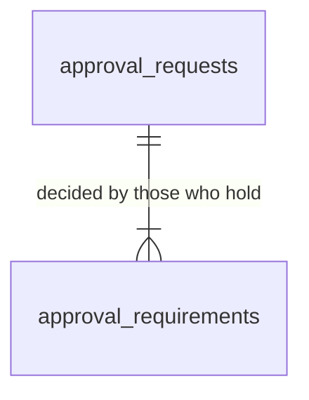
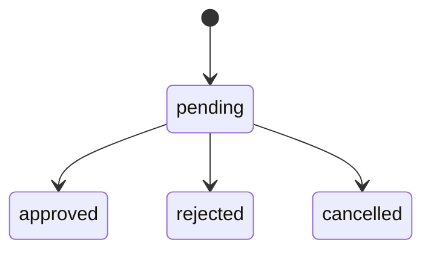

# Approvals

- Status: Built for Deployments ([#39](https://github.com/ivaldibuild/ivaldi/issues/39), [#40](https://github.com/ivaldibuild/ivaldi/issues/40)); matching an `ApprovalID` and replacing a pending request wait for a subject that needs them (see [Building it](#building-it))
- Date: 2026-11-17
- Related: [ADR 0003](../adr/0003-identity-access-and-policy.md), [ADR 0005](../adr/0005-data-model-ownership.md), [ADR 0007](../adr/0007-teams-and-agent-identity.md), [ADR 0011](../adr/0011-transactional-outbox.md), [delivery data model](delivery-data-model.md), [deployment variables](deployment-variables.md), [workspace data model](workspace-data-model.md)

This document defines how the control plane records requests for a human's approval, lists them, and decides them. Approval requests belong to the policy capability (`apps/control-plane/internal/policy`): [ADR 0003](../adr/0003-identity-access-and-policy.md) puts approval workflows in the control plane's policy capability, and [ADR 0007](../adr/0007-teams-and-agent-identity.md) has policy hold what waits for approval.

The first thing that waits is a Deployment. When the single authorizer returns `requires_approval`, `POST /v1/releases/{release_id}/deployments` creates the Deployment in `awaiting_approval`, but nothing records what it waits for, lists it, or decides it. Later, a refresh of a Release's variables that changes production ([deployment variables](deployment-variables.md#refreshes-that-change-production-need-approval)), a setting change by an agent Session ([workspace data model](workspace-data-model.md)), and publishing a Release for an autonomous Session ([delivery data model](delivery-data-model.md)) wait for approval the same way, so the record is not specific to Deployments.

## Decisions this model is built on

- **Policy owns approval requests, and the subject's capability owns the subject.** A request refers to what waits, its *subject*, by type and ID, such as `delivery.deployment` and a Deployment ID. Delivery keeps the Deployment and its status. Policy keeps the request, its state, and who decided it. Neither reads the other's tables ([ADR 0005](../adr/0005-data-model-ownership.md)).
- **The subject's capability opens the request, in the transaction that makes the subject wait.** The authorizer is called before the subject exists, and the subject can still fail its own checks after the decision, so the authorizer does not open requests. When delivery creates a Deployment in `awaiting_approval`, it opens the request through policy's interface in the same transaction. A Deployment never waits without a request, and no request is left behind for a Deployment that was never created.
- **A request is pending exactly while its subject waits.** Whatever moves the subject out of waiting closes the request in the same transaction:
  - approving moves the Deployment to `applying`;
  - rejecting moves it to `rejected`;
  - cancelling the Deployment cancels the request;
  - withdrawing its Release, or archiving its Target or Application, cancels both (see below).

  If the subject's capability later adds another way out of waiting, it must close the request there too.
- **Anything that makes a waiting subject impossible to apply cancels it and its request.** Otherwise the request would stay pending until someone tried to approve it and the subject's checks refused. For Deployments, this happens when the Release is withdrawn, or when the Target or the Application is archived. An Environment cannot be archived while it has active Targets, and a Project cannot be archived while it has active Applications, so those two cases are already covered. Deployments that are already applying are left alone, as they are today.
- **Requests do not expire, for now.** A request ends only when someone approves, rejects, or cancels it. Until then, a waiting Deployment holds its Target: the deploy plan's in-flight check counts it, so no other Deployment of the Application to that Target can be requested. Expiry needs a scheduled job, and is deferred until the worker runs them.
- **A new request for a subject that has a pending one replaces it.** The earlier request is cancelled, with a note naming the new one, in the same transaction. Deployments never reach this case, because the in-flight check refuses a second Deployment to the same Target. A refreshed variable revision or a new setting change can, as [deployment variables](deployment-variables.md#refreshes-that-change-production-need-approval) already expects ("refreshing again replaces it"). Replacing is built with the first such subject; until then, opening a second pending request for a subject fails on the unique index.
- **Capabilities register their subject types with policy.** Settings work the same way: each capability registers its definitions in `workspace.Definitions`. Here, each capability registers its subject types in a `policy.Subjects` registry at startup; delivery registers `delivery.deployment`. A registration provides the handler policy calls when a request is approved or rejected, which locks the subject and changes it in the same transaction. The Go type of each subject's summary is passed to the approvals controller where the routes are listed (`cmd/server/routes.go`), so the API description lists its fields as a `oneOf`: the description is built without wiring, so it cannot read a registry filled at startup.

  Policy imports no capability that registers subjects. Delivery imports policy, as it already imports `workspace` and `team`.
- **A decision names the rule that required approval.** `authorization.Decision` gains `Rule`, a stable identifier such as `builtin.agent_session_release`, beside the human-readable `Reason`. The request copies both, so approvers see why it waits, and requests can later be filtered by rule. Built-in rules start with `builtin.`. Rules an Organization writes will get their own IDs once a policy engine exists.
- **The authorizer gets its policy half.** `iam/authorizer` is IAM's half of the single authorizer. `policy.NewAuthorizer` wraps it and applies the built-in rules after IAM allows. Three built-in rules live there:
  - the agent Session rule that returns `requires_approval`;
  - the rule on who may approve or reject;
  - matching a request that carries an `ApprovalID`.

  Callers still make one call ([ADR 0003](../adr/0003-identity-access-and-policy.md)).
- **An approver must be able to do it themselves** ([ADR 0007](../adr/0007-teams-and-agent-identity.md)). A request records what access deciding it needs: its *requirements*, each a permission on an IAM resource. The subject's capability gives the checks the gated action made. For a Deployment, those are `deployment.create` on the Target's Environment and `application.read` on the Application's Project. An approver must:
  - be a human user, never an Agent, an agent Session, or a service account;
  - hold every requirement;
  - be neither the requester nor the person the requesting Session acts for.

  Deciding needs no permission of its own, so it lets no one ship what they could not ship directly, and IAM's roles do not change.
- **The list shows only what the caller could decide.** `GET /v1/approvals` returns requests whose requirements the caller holds, in whichever `state` is asked for. It leaves out requests the caller made or that their Sessions made for them. A caller who is not a user gets an empty list. A requester follows their request through its subject, such as the Deployment's status, or through `GET /v1/approvals/{id}`. A view of one's own requests is deferred. The filter runs in the database, so the list pages by cursor and counts like every other list (see [Listing what is waiting](#listing-what-is-waiting)).
- **Reading one request follows the subject.** Anyone who can read the subject can read its request, so the Deployment page can show what a Deployment waits for, even to people who cannot decide it. The subject's capability names the resource the request is read on; for a Deployment, that is the Application's Project. Policy checks `approval.read` there. Every role holds it, by IAM's rule for read permissions.
- **The request keeps what the approver is shown.** The subject's capability gives a *summary* when it opens the request. For a Deployment, it holds:
  - the Application;
  - the Release and its version;
  - the Environment and its tier, and the Target;
  - the reason (`rollout`, `redeploy`, or `rollback`) and, for a rollback, the Deployment it restores;
  - whether secrets resolve to their latest versions.

  It is a snapshot: approvers see what was asked, and listing needs no call into delivery. Principal and Team names are not copied; the web app reads them through `/v1/principals` and the Teams API.
- **An approval is bound to what was asked.** The request stores the gated authorization request: its action, permission, and resource, and a SHA-256 digest of its canonical proposal. Approved subjects take effect in one of two ways:
  - **Resume**: the subject is stored while it waits, like a Deployment, a pending variable revision, or a draft Release. Approving applies it directly, in the same transaction. The requester is not authorized again, because the Session that asked may have ended, and [ADR 0007](../adr/0007-teams-and-agent-identity.md) makes the approver accountable for what ships. But if the requesting Session was *revoked*, rather than simply ended, approving is refused, so a Session cut off for misbehaving cannot ship its work through someone else's approval. Its request can still be rejected or cancelled.
  - **Resubmit**: nothing is stored while it waits, like a setting change. The requester asks again with the decision as `ApprovalID`, and the authorizer allows it only when the request is approved and the requester, action, resource, and proposal digest all match.
- **A request goes to the Team that owned the subject when it was asked.** The subject's capability gives the owning Team; for a Deployment, that is the Application's owning Team. The request keeps it, and a later handover does not move requests already waiting. Routing is not access: anyone who meets the requirements may decide, whether or not they are in the Team. So the Team only decides who is told and what the `owner_team_id` filter matches, and following a handover would buy little for a hook into delivery's `TransferTo`.
- **Requests are never deleted.** A decided or cancelled request keeps its state, who closed it, when, and their note. It is the record behind the decision IDs on the subject.
- **Every change is audited and emits an event.** Policy writes the audit record and the outbox event ([ADR 0011](../adr/0011-transactional-outbox.md)) in the subject's transaction. The created event carries `owner_team_id`, so the capability that notifies people can route it. Nothing consumes it yet.
- **Conventions match the other capabilities.** Tables live in the `policy` schema, every table has `organization_id`, and IDs are prefixed ULIDs stored as `varchar(30)`. References to other capabilities, here subjects, principals, Teams, and IAM resources, have no foreign key.

  | Table | Prefix |
  |---|---|
  | approval_requests | `apr` |

  Requirements are child records, keyed by their request, permission, and resource.

## Entities

- **approval_requests**: one request for a human's approval. Its fields:
  - `subject_type` and `subject_id` name what waits. `subject_id` is a string of at most 300 characters, because a setting change has no record of its own; its subject is the level and key.
  - `state` is `pending`, `approved`, `rejected`, or `cancelled`.
  - `decision_id` is the authorizer's `requires_approval` decision, unique across requests, so a resubmitted `ApprovalID` finds its request.
  - `rule` and `reason` come from that decision.
  - `action`, `permission`, `resource_id`, and `proposal_digest` describe the gated authorization request.
  - `summary` is what approvers are shown, as JSON of at most 64 KB.
  - `read_resource_id` is where `approval.read` is checked.
  - `owner_team_id` is the Team it is routed to; it is NULL when the subject has no owning Team, such as an Organization setting.
  - `requested_by_principal_id` is the principal that asked: a user, a service account, or an agent Session's principal.
  - `session_id` is the Session that asked, if any.
  - `on_behalf_of_principal_id` is that Session's delegator, read from IAM when the request is opened. It is NULL for an autonomous Session.
  - `closed_by_principal_id`, `closed_decision_id`, `note`, and `closed_at` record who approved, rejected, or cancelled it, under which decision, and why. `note` is at most 2,000 characters.
- **approval_requirements**: one permission on one IAM resource that a decider must hold. `resource_path` is the resource and its ancestors up to the Organization's root resource, read from IAM when the request is opened. Workspaces, Projects, and Environments never move, so the path stays correct.

`approved`, `rejected`, and `cancelled` are final.

## How the main flows work

### Requesting a Deployment that needs approval

1. Delivery's authorizing wrapper asks about `deployment.create` on each Target's Environment. The decision is `requires_approval`, with its ID, rule, and reason.
2. In the request's transaction, delivery runs the deploy plan as before. It creates the Deployment in `awaiting_approval`, with `policy_decision_id` set to that decision.
3. In the same transaction, delivery opens the request through `policy.Approvals`. It passes:
   - the subject;
   - the gated authorization request and its decision;
   - the actor;
   - the requirements;
   - the read resource, the owning Team, and the summary.
4. Policy then:
   - reads the Session's delegator from IAM, when the actor is an agent Session;
   - reads each requirement's resource path from IAM (`ResourceAncestors`);
   - inserts the request and its requirements;
   - writes the `approval_request.created` audit record and the `policy.v1.approval_request.created` event.
5. Delivery stores the request's ID on the Deployment (`approval_request_id`).

The waiting Deployment's `finished_at` is NULL, so it holds its Target until it is decided or cancelled (see "Requests do not expire, for now" above).

### Listing what is waiting

`GET /v1/approvals` takes `state` (default `pending`), `subject_type`, and `owner_team_id`, and pages by cursor, newest first.

1. If the caller is not a user, the result is an empty page.
2. Policy reads the distinct permissions that the matching requests' requirements name. There are only a few.
3. For each permission, policy asks IAM which resources the caller holds it on. IAM returns resources where all of these are true:
   - the caller has a grant, directly or through a group;
   - the grant has not expired;
   - the resource is not archived;
   - the grant's role includes the permission.

   That is the caller's own grants, usually a handful, not every resource beneath them.
4. Policy selects the requests where every requirement's `resource_path` overlaps the resources granted for its permission. It leaves out requests whose `requested_by_principal_id` or `on_behalf_of_principal_id` is the caller.

The filter is the same for every `state`. With `state=approved`, for example, the list shows the approved requests the caller could have decided, which serves as a history of what their access covers.

Each item carries `can_decide`, which reflects the caller's access now. In the list it is true for every pending item. It is part of the response shared with `GET /v1/approvals/{id}`, where it can be false.

### Reading one request

`GET /v1/approvals/{id}` checks `approval.read` on the request's `read_resource_id`, and works out `can_decide` for the caller the same way the list filters. The Deployment page finds the request through its `approval_request_id`.

### Cancelling a waiting Deployment

`CancelDeployment` locks the Deployment, moves it to `cancelled`, and calls `policy.Approvals.Cancel` for its subject. That call moves the pending request to `cancelled`, records the person who cancelled it, and writes its audit record and event, all in the same transaction.

### Withdrawing a Release, or archiving a Target or Application

In the transaction that withdraws the Release, or archives the Target or Application, delivery does this for each of its Deployments in `awaiting_approval`:

1. It locks the Deployment and moves it to `cancelled`.
2. It calls `policy.Approvals.Cancel`, recording the actor as the one who closed the request, with a note saying why, such as "Release withdrawn".

Each cancelled Deployment gets its own audit record and events, as a cancel does. Deployments that are already applying are not touched.

### Approving

Approving takes `POST /v1/approvals/{id}/approve` with an optional `note`.

1. The approver asks the authorizer for `approval.approve`, once for each requirement's permission and resource. IAM checks the approver's access. Policy's built-in rule refuses anyone who is not a user, and anyone who is the requester or the person the requesting Session acts for. Approving itself can never require approval; that outcome is refused.
2. In one transaction, the subject's handler locks the subject, then policy locks the request and refuses it unless it is `pending`. If the request was made by an agent Session, policy reads the Session from IAM and refuses when it was revoked. A Session that merely expired or ended is fine.
3. Policy marks the request `approved`, recording the approver, the decision from step 1, the note, and the time.
4. The handler resumes the subject:
   - Delivery runs the deploy plan's checks again: the Release is still published, the Target is active, the Lifecycle phase is open, and bindings and secret stores still check out.
   - If a check fails, the approval is refused and the transaction rolls back. The request stays pending, and the approver can reject it instead.
   - Otherwise delivery moves the Deployment to `applying`, sets `started_at`, and sets `policy_decision_id` to the approval's decision, whose `ApprovedByPrincipalID` names the approver.

Both capabilities write their audit records and events in that same transaction.

### Rejecting

Rejecting is the same as approving with `approval.reject`, except that a revoked Session does not block it, and the note is required. The requester, often an agent, then learns why it was refused and can ask again properly. Approving stays one step, with an optional note. ([#40](https://github.com/ivaldibuild/ivaldi/issues/40) suggested an optional note for both.) The handler moves the Deployment to `rejected`, which sets `finished_at` and frees the Target.

### Lock order

Approving, rejecting, and cancelling all lock the subject before the request. Two of them on the same request cannot deadlock: the second waits, then finds the request no longer pending.

Requesting a Deployment, and the handler's lock before approving or rejecting one, first take shared locks on its Release, its Application, and its Targets, in that order and the Targets by ID. Withdrawing a Release and archiving a Target or Application lock that row for update before cancelling the Deployments waiting there. So a withdrawal or archive either commits first, and the request's or approval's checks see it, or waits until the request has committed its waiting Deployment, which it then finds and cancels. Every path takes these rows before the Deployment, and the Deployment before its request, so none of them can deadlock.

## Other subjects

These follow the same record and flows; each is built when its capability needs it.

- **Refreshing a Release's variables that changes production** (`delivery.variable_revision`, resume). The new revision waits as `pending_approval`. Approving makes it current, and rejecting marks it `rejected`. Its summary lists the variables that change, for which Targets, from what to what, with secrets shown as references. Its requirements are `variable.manage` on each production Environment it touches. Until it is built, such a refresh stays refused with `delivery.ErrProductionChange`.
- **An agent Session's setting change** (`workspace.setting`, resubmit). The subject is the level and key, and the summary holds the proposed value and the setting's version when it was asked. Once approved, the Session sends the change again with `approval_id`. The workspace capability refuses it if the version has moved, and the approval then lapses ([ADR 0007](../adr/0007-teams-and-agent-identity.md)).
- **Publishing a Release for an autonomous Session** (`delivery.release`, resume). The Release stays a draft, and approving publishes it, setting `publish_decision_id`.

## Invariants

- **Every Deployment in `awaiting_approval` has exactly one pending request, and every pending request's subject is waiting.** The subject's capability opens and closes requests in the transactions that change the subject.
- **A subject has at most one pending request.** A partial unique index on `(organization_id, subject_type, subject_id)` where `state = 'pending'` enforces it.
- **A request leaves `pending` once.** Its other states are final.
- **No request stays pending for a subject that can no longer be applied.** Withdrawing a Release, or archiving a Target or Application, cancels its waiting Deployments and their requests.
- **Work from a revoked Session is never approved.**
- **A decided request names a human user who held every requirement when they decided, and who is neither the requester nor the person the requesting Session acts for.**
- **An `ApprovalID` allows only what was approved**: the same requester, action, resource, and proposal digest.
- **Nothing changes without an audit record.** Each state change is audited, and its event is written to the outbox, in the subject's transaction.

## Building it

The work is split across three issues:

- **[#39](https://github.com/ivaldibuild/ivaldi/issues/39), record and list requests:**
  - `Decision.Rule`;
  - the tables and the domain type, which can be opened and cancelled;
  - the `policy.Subjects` registry and the `policy.Approvals` interface;
  - IAM's query for the resources a principal holds a permission on;
  - `GET /v1/approvals` and `GET /v1/approvals/{id}`;
  - delivery opening and cancelling requests, and its `approval_request_id` column;
  - delivery cancelling waiting Deployments and their requests when a Release is withdrawn, or a Target or Application archived;
  - `make openapi`.
- **[#40](https://github.com/ivaldibuild/ivaldi/issues/40), approve and reject:**
  - `policy.NewAuthorizer` with the approver rule. `ApprovalID` matching is left for the first subject that is sent again rather than stored, such as a setting change: until then nothing could send one, and IAM's authorizer still refuses any request that carries one. The request already stores the proposal digest it will match;
  - the approve and reject endpoints, with a note required to reject;
  - the IAM lookup that refuses approving a revoked Session's request;
  - delivery's handler for `delivery.deployment`.
- **[#41](https://github.com/ivaldibuild/ivaldi/issues/41), the agent Session rule:** it returns `requires_approval` with its `Rule`. Until #41 lands, nothing outside tests reaches `awaiting_approval`. #39 and #40 can still be built and tested against a fake authorizer.

The web app's "Needs attention" strip and the approval card on the Deployment page follow.

## Deferred

- **Expiry and escalation** ([ADR 0007](../adr/0007-teams-and-agent-identity.md)). Requests end only when someone decides or cancels them, and a waiting Deployment holds its Target until then. Expiring or escalating needs a scheduled job; it would add an `expired` state and is revisited once the worker runs scheduled jobs.
- **Seeing one's own requests.** A view such as `?requested_by=me`, for an agent Session or the person it acts for. Until then, requesters follow the subject, or read their request by ID.
- **More than one approver.** Some Organizations will want two people to approve production. The record has one decider; a second would need approvals as child records.
- **Approvers named by policy.** Policy may name approvers other than the owning Team ([delivery data model](delivery-data-model.md)). Requirements say who *may* decide, and the owning Team says who is *asked*. Naming others would add to the routing, not to the requirements, so it can come later without changing the record.

## Open questions

- **Emergency rollback.** Whether rolling back to the previous healthy Release may skip approval when policy allows it explicitly is [ADR 0007](../adr/0007-teams-and-agent-identity.md)'s question to settle. Until it does, a rollback an agent Session asks for waits for approval like any other Deployment.

## Appendix: planned schema

The migrations will live in [`apps/control-plane/internal/policy/migrations/`](../../apps/control-plane/internal/policy/migrations/), with versions kept in `public.policy_schema_migrations`.

| Capability | Migration | Creates | Scope |
|---|---|---|---|
| policy | 000003 | `approval_requests`, with the pending-per-subject unique index, a unique `decision_id`, and an `(organization_id, state, created_at, id)` index for listing | tenant |
| policy | 000004 | `approval_requirements`, keyed by `(approval_request_id, permission, resource_id)`, referencing `approval_requests` through `(organization_id, approval_request_id)` | tenant |
| delivery | next | `approval_request_id` on `deployments`, nullable | tenant |
