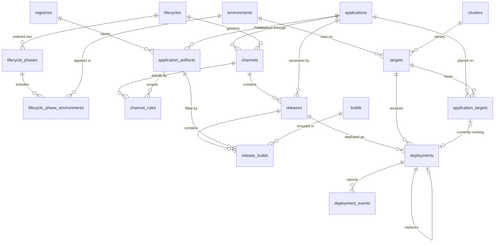

# Delivery data model

- Status: Draft for review
- Date: 2026-10-18
- Related: [ADR 0001](../adr/0001-deployment-topology.md), [ADR 0003](../adr/0003-identity-access-and-policy.md), [ADR 0004](../adr/0004-credentials-and-keys.md), [ADR 0005](../adr/0005-data-model-ownership.md), [ADR 0006](../adr/0006-release-and-delivery-tracking.md), [ADR 0007](../adr/0007-teams-and-agent-identity.md), [IAM data model](iam-data-model.md)

This document defines the data model for the delivery capability in the control plane (`apps/control-plane/internal/delivery`). The capability records what was built, what was released, and where it runs, whether Ivaldi deployed it or another tool did ([ADR 0006](../adr/0006-release-and-delivery-tracking.md)). It also holds each Application's release strategies: which Releases are allowed, and which Environments they move through in what order. Once this model is approved, the schema in the appendix becomes the capability's first migrations, and the Go domain types and repository interface follow from it. The shared status values, transition rules, version comparison, and rule matching live in `pkg/release`.

Several concepts follow Octopus Deploy: [channels](https://octopus.com/docs/releases/channels), and the package, feed, and build-information model in [packaging applications](https://octopus.com/docs/packaging-applications). Where this model differs, the reason is noted.

## Decisions this model is built on

- **A Release versions an Application.** An Application is a deployable unit inside a Project, such as an API, a web app, or a background worker. A Project can have several, and each one is released and deployed on its own.
- **Every Application is owned by a Team of humans and agents.** The owning Team is responsible for the Application: approval requests, alerts about degraded Deployments, findings on observed Deployments, and Work Items from incidents are routed to it. Ownership grants no access; access comes from IAM grants ([ADR 0007](../adr/0007-teams-and-agent-identity.md)).
- **An Application declares the artifacts it is made of.** For example, an API might consist of an `api` image, a `migrate` image, and a Helm chart. A Release contains one Build for each artifact. Because the Helm chart is an artifact too, how to deploy a Release is versioned with the Release rather than configured beside it. This plays the role of the package references in an Octopus deployment process.
- **A Build is one version of one artifact, identified by its digest.** A Build can carry a version reported by CI, such as `1.4.0` or a chart version, but its identity is always the digest, never a tag, because tags can be moved. This differs from Octopus, which identifies a package by ID and version and reads container tags as versions.
- **Every Release belongs to a Channel.** A Channel is one release strategy for an Application, such as mainline, hotfix, or early access. Its rules decide which Releases may join it, for example "versions without a pre-release tag" or "built from a `hotfix/*` branch". Its Lifecycle decides where those Releases may be deployed and in what order. Every Application has exactly one default Channel, created with it.
- **Lifecycles are shared across a Workspace.** A Lifecycle is an ordered list of phases, each naming one or more Environments. Like Environments, Lifecycles belong to the Workspace, so a standard path (development → staging → production) or a hotfix path (production first) is defined once and used by many Channels.
- **Registries are recorded, and lookups run where the registry can be reached.** A Registry is where artifacts are stored, such as an OCI registry. Ivaldi needs one only to look up artifacts, for example to resolve a tag to a digest or to fetch a chart when executing. Under bring-your-own-compute, the control plane cannot reach a customer's private registry ([ADR 0001](../adr/0001-deployment-topology.md)), so a Registry can be marked for lookup from the data plane. As in Octopus, the clusters themselves pull images; Ivaldi does not move images.
- **What changed between Releases is computed from commits, not stored.** Octopus stores the commits and work items that CI pushes as build information. Ivaldi already owns VCS integration and Work Items, so it stores only each Build's commit and derives the commits, Changes, Sessions, and Work Items between two Releases from the source of truth.
- **Executed and observed Deployments share one table.** `source` records whether Ivaldi applied the Deployment or saw another tool apply it. History, provenance, and "what is running where" work the same way for both.
- **Every Deployment has a Release.** When the agent sees a change that matches no known Release, the control plane creates an observed Release from the digests it saw. Queries never have to handle a Deployment without a Release.
- **Rules are enforced on executed Deployments and reported on observed ones.** Ivaldi refuses to execute a Deployment that breaks its Channel's Lifecycle. It cannot stop another tool, so it records any rule an observed Deployment broke as a finding.
- **Delivery tables live in their own PostgreSQL schema, `delivery`.** The conventions match the IAM model: every tenant-scoped table has `organization_id` and a `unique (organization_id, id)` key, child tables use composite foreign keys, and tenant filtering is enforced in application code ([ADR 0005](../adr/0005-data-model-ownership.md)).
- **References to other capabilities have no foreign key.** Workspaces, Projects, Sources, Teams, Sessions, Work Items, IAM principals, policy decisions, and credential references are stored as plain IDs, as `iam.agent_sessions` already does for Sessions and Work Items.
- **Primary keys are prefixed ULIDs generated by the application**, stored as `varchar(30)`. Prefixes are unique across all capabilities, not only within this one.

  | Table | Prefix |
  |---|---|
  | environments | `env` |
  | lifecycles | `lfc` |
  | lifecycle_phases | `lfp` |
  | targets | `tgt` |
  | registries | `reg` |
  | applications | `app` |
  | application_artifacts | `art` |
  | channels | `chn` |
  | channel_rules | `chr` |
  | builds | `bld` |
  | releases | `rel` |
  | deployments | `dep` |
  | deployment_events | `dpe` |

  `lifecycle_phase_environments`, `application_targets`, and `release_builds` are join tables with composite primary keys.
- **Enumerated values are validated in Go, not by database constraints.** This matches the IAM model. Status values and their transitions are defined once, in `pkg/release`, and both planes use them.
- **Runtime-specific and rule-specific data is JSON validated in Go.** A Target's location, an Application's workload selector, apply settings, and a Channel rule's parameters differ by runtime or rule kind. They are `jsonb` columns validated by the runtime provider or by `pkg/release`, so adding a runtime or rule kind does not change the schema.
- **No secrets are stored.** The agent reaches its cluster with its own in-cluster identity, so Targets and Clusters hold no cluster credentials. Registries and apply settings refer to secrets only through credential references ([ADR 0004](../adr/0004-credentials-and-keys.md)).

## Entities

Projects and Workspaces are owned by the [workspace capability](workspace-data-model.md). Applications point to their Project, and Environments, Lifecycles, and Registries point to their Workspace, by ID. Delivery registers with the workspace capability as a dependent: it refuses the archiving of a Project that still has active Applications, and of a Workspace that still has active Environments, Lifecycles, or Registries.

### Where things run

- **environments** — a named stage in a Workspace, such as staging or production. Each has a `slug` that is unique within the Workspace, a display name, and a `tier` (`development`, `staging`, `production`, or `other`) that policy rules can match on. `execution_enabled` turns on Ivaldi-driven deployments; when it is off, the Environment is tracked only. When the delivery capability creates an Environment, it registers the Environment with IAM as a resource under its Workspace ([IAM data model](iam-data-model.md)).
- **clusters** — a Kubernetes cluster an Organization deploys to. It belongs to the Organization, not a Workspace, because one cluster usually hosts several Workspaces' Environments ([ADR 0014](../adr/0014-agents-serve-clusters.md)). It has a `slug` unique in the Organization and immutable after creation, a display name, a `runtime` (`kubernetes`), the agent's `agent_principal_id`, the cluster-wide `agent_capabilities` from its last heartbeat, the `agent_last_failure` of a refused enrolment, and `last_reported_at`. One runtime agent serves the Cluster and every Target in it. A Cluster with active Targets cannot be archived; archiving one without them suspends the agent and revokes its credentials.
- **targets** — a concrete place an Environment runs, such as a namespace in a Cluster. `environment_id` names the Environment and `cluster_id` the Cluster whose agent serves it; `runtime` names the provider (`kubernetes` first, and each runtime has its own agent, [ADR 0013](../adr/0013-one-agent-per-runtime.md)). `locator` holds the runtime's non-secret address; for Kubernetes, `cluster` is the Cluster's slug and `namespace` the namespace. `can_observe`, `can_execute`, and `capability_reason` are what the Cluster's agent last reported it can do in that namespace. One active Target may use a Cluster namespace, enforced by a unique index on `(organization_id, cluster_id, namespace)`. A Target's `slug` is unique within its Environment. Targets are not IAM resources; access to a Target follows its Environment.

### How Releases move: Lifecycles

- **lifecycles** — an ordered path through a Workspace's Environments. Has a `slug` that is unique within the Workspace, a display name, and a description. A Lifecycle cannot be deleted while an active Channel uses it.
- **lifecycle_phases** — one step in a Lifecycle, at a `position` that is unique within the Lifecycle. A phase has a name, an `optional` flag, and `min_environments`: how many of the phase's Environments must have a successful Deployment of a Release before the next phase opens for it. NULL means all of them.
- **lifecycle_phase_environments** — the Environments in each phase. It carries `lifecycle_id` so that `(lifecycle_id, environment_id)` can be unique: an Environment appears at most once in a Lifecycle.

A phase is **open** for a Release when every earlier phase that is not optional has met its `min_environments`. The first phase is always open. A Deployment is **successful** once it has reached `healthy`, even if it is later superseded; `deployments.succeeded_at` records that moment. Releases can be redeployed to any Environment in a phase that is already open, so an earlier Environment can be redeployed at any time.

### Where artifacts are stored: Registries

- **registries** — a place artifacts are stored, owned by a Workspace. `kind` names the protocol (`oci` first, which covers container images and OCI-hosted Helm charts). `url` is its address, and `slug` is unique within the Workspace. `credential_ref` points to the credentials capability when the Registry needs authentication ([ADR 0004](../adr/0004-credentials-and-keys.md)). `lookup_from` is `control_plane` or `data_plane`. When it is `data_plane`, lookups run through a data-plane workload in `lookup_pool`, so neither the credential nor the request leaves the customer's environment.

Ivaldi uses a Registry only for lookups: resolving a tag to a digest when a Release is created, listing versions for automatic Release creation, and fetching a chart when the agent executes a Deployment. Tracking does not need one. Clusters pull images with their own pull credentials, as they do today.

### What gets deployed

- **applications** — a deployable unit in a Project. Has a `slug` that is unique within the Project, a display name, an `owner_team_id` naming the Team that owns it, and an optional `source_id` naming the Source it is usually built from. A new Application's owner defaults to its Project's owning Team ([workspace data model](workspace-data-model.md)), and is its own from then on. Ownership can be handed to another Team at any time; the change is recorded as an audit event. `workspace_id` is copied from the Project, so the capability can check that the Application's Lifecycles, Registries, and Targets belong to the same Workspace. `workload_selector` tells the agent how to recognize the Application's workloads, for example a Kubernetes label selector; it defaults to the label `ivaldi.build/application=<application id>`. Applications are archived, never hard-deleted, because Deployments refer to them. They are not IAM resources; access follows their Project.
- **application_artifacts** — the artifacts an Application is made of. Each has a `name` that is unique within the Application (such as `api`, `migrate`, or `chart`), an `artifact_kind` (`container_image`, `helm_chart`, or `archive`), the `artifact_name` its Builds are published under (for example `ghcr.io/acme/api`), and an optional `registry_id`. `required` says whether every Release must include a Build of it. `source` is `declared` when someone set it up, or `observed` when the agent found an image in the Application's workloads that matched no declared artifact. Teams that only track deployments never have to declare artifacts; they are filled in as the agent sees them.
- **application_targets** — the Targets an Application runs on, one row per pair. `source` is `configured` when someone set up the placement, or `observed` when the agent found the Application on a Target first. `apply_config` holds how to apply a Release when Ivaldi executes: which of the Release's artifacts holds the deployment definition (for example the `chart` artifact) and the chart-relative overlay values files to apply, in order. The files are part of the chart artifact, so the chart's digest pins them. It is used only for executed Deployments. `current_deployment_id` and `current_release_id` point to what is running now. They are updated in the same transaction that changes which Deployment is current, so "what is running where" is a single indexed read.

### Release strategies: Channels

- **channels** — one release strategy for an Application. Has a `slug` that is unique within the Application, a display name, a description, and the `lifecycle_id` it follows. `is_default` marks the Application's default Channel; a partial unique index allows only one per Application. Channels are archived, not deleted, because Releases refer to them.
- **channel_rules** — the conditions a Release must meet to join the Channel. A Release joins only if it meets every rule. `kind` selects the rule, `artifact_id` optionally scopes it to one of the Application's artifacts, and `config` holds its parameters, validated by `pkg/release`:
  - `version` — matches a version. With no `artifact_id`, it matches the Release's version; with one, it matches the version of that artifact's Build. `config` is either a SemVer range with an optional pre-release tag pattern (for example `[2.0,3.0)` with `^$` for no pre-release, or `^beta` for betas), or, for versions that are not SemVer, a pattern for the whole version string (for example `^build-\d+$`).
  - `git_ref` — matches the Git refs that Builds were built from, as glob patterns such as `refs/heads/main` or `refs/heads/hotfix/**`. With no `artifact_id`, every Build in the Release must match; with one, only that artifact's Build must, so a rule can apply to the `api` image but not to a third-party sidecar.

  `config` is stored in canonical form, so equal rules store equal JSON: `{"range":"[2.0,3.0)","pre_release":"^$"}` or `{"pattern":"^build-\\d+$"}` for `version`, and `{"patterns":["refs/heads/main"]}` for `git_ref`. Version ranges use NuGet's interval notation (`1.0`, `[1.0]`, `[1.0,2.0)`, `(,2.0]`), as Octopus does.

### What was built and released

- **builds** — one version of one artifact, identified by `artifact_name` and `digest`. The pair is unique within an Organization. `artifact_kind` matches the artifact kinds above. A CI-reported Build records its `version` (if CI gave one), `source_id`, `commit_sha`, `source_ref` (the branch or tag it was built from), `ci_provider`, `ci_run_ref`, and `built_at`, and its `provenance` is `ci_reported`. A Build that the agent saw running without any CI record is created with `provenance` set to `observed` and no commit. `reported_tags` lists tags seen with the digest, as hints only.
- **releases** — one version of an Application in one Channel. `version` is unique within the Application, across all its Channels, and is parsed and compared by `pkg/release`. `channel_id` cannot change once the Release is published. `status` runs `draft` → `published`, and a published Release can be `withdrawn` to stop new Deployments of it. `source` is `created` (by a person, an agent Session, or CI through the API) or `observed`. Observed Releases get a generated version based on their digests. `created_by_principal_id` records who created it, and `publish_decision_id` refers to the authorizer's decision that allowed it to be published, including any human approval.
- **release_builds** — the Build for each artifact in a Release, keyed by `(release_id, artifact_id)`. The Build's `artifact_name` must match the artifact's. The agent matches running workloads to artifacts by `artifact_name`. A Release's Builds cannot change once it is published.

### Deployments

- **deployments** — one Release of an Application applied to one Target.
  - `source` is `executed` or `observed`.
  - `reason` is `rollout`, `rollback`, or `redeploy`. A rollback is a new Deployment of an earlier Release, not a status on the old one.
  - `status` follows the transitions in `pkg/release` (see below). `succeeded_at` records when it first reached `healthy`, which is what Lifecycle progression counts.
  - `previous_deployment_id` is the Deployment this one replaced on the same Target.
  - `application_id` and `environment_id` are copied from the Release and the Target, for queries and for the progression check.
  - Trigger and provenance: `initiated_by_principal_id`, `session_id`, and `work_item_id` for executed Deployments; `external_ref` for observed ones, such as the deployer and its own revision.
  - Policy: `policy_decision_id` refers to the authorizer's decision. Observed Deployments are evaluated after the fact.
  - `findings` lists the rules an observed Deployment broke: `outside_lifecycle` (its Environment is not in the Channel's Lifecycle), `phase_not_open` (an earlier phase was skipped), `would_require_approval`, or `would_deny`. It is empty when nothing was broken, and always empty for executed Deployments, which are refused instead.
  - Timing: `requested_at`, `started_at`, `finished_at` (when the rollout ended), and `status_changed_at`.
- **deployment_events** — an append-only history of status changes, progress, and health reports. Each event records who reported it, the status it moved to (if any), runtime-specific `detail`, the time it happened (`occurred_at`), and the time it was stored (`recorded_at`). Agents send a `report_id` with each event, and `(deployment_id, report_id)` is unique, so a retried report is stored once.

### Deployment status

| Status | Meaning | Terminal |
|---|---|---|
| `pending` | An executed Deployment was requested and is waiting for its policy decision. | No |
| `awaiting_approval` | Policy requires a human approval before it is applied. | No |
| `rejected` | Policy denied it, or the approval was refused. | Yes |
| `cancelled` | Stopped before it was applied. | Yes |
| `applying` | The agent is applying it. | No |
| `progressing` | The rollout is in progress. Observed Deployments start here. | No |
| `healthy` | The rollout finished and the workloads are healthy. | No |
| `degraded` | The rollout stalled, or workloads became unhealthy after it finished. | No |
| `failed` | The rollout failed. | Yes |
| `superseded` | A later Deployment replaced it on the Target. | Yes |

`healthy` and `degraded` are not terminal: while a Deployment is current, its status keeps following the workloads' health. `finished_at` marks the end of the rollout, not the end of the Deployment's life.

## How the main flows work

**Recording a Build.** CI reports through the gateway's webhook module or the API, with the digest and, ideally, the commit, ref, and version. A report can arrive before or after the artifact is pushed, and before or after the agent sees it running. The capability creates the Build, or, if the agent already saw the digest, fills in its CI details and changes `provenance` to `ci_reported`. That upgrade is the only change ever made to an existing Build. A later report that gives a different commit for the same digest is refused and recorded as an audit event, because it means either a CI misconfiguration or tampering.

**Creating and publishing a Release.**
1. A person, an agent Session, or CI creates a Release for an Application with a version and its Builds, and can name a Channel. Builds can be given by digest, or by tag; a tag is resolved to a digest through the artifact's Registry at that moment, and the digest is what the Release keeps.
2. If a Channel is named, the Release must meet that Channel's rules. If none is named, `pkg/release` checks every active Channel of the Application. If exactly one matches, the Release joins it. If none match, or more than one does, the request is refused, and the refusal names the candidates. Channels should be set up so their rules do not overlap; for example, a default Channel that takes only versions without a pre-release tag (`^$`) and a beta Channel that takes only `^beta`.
3. A draft's Builds can still change, so the rules are checked again when it is published. Publishing also checks that every required artifact has a Build. Publishing fixes the Release's Channel and Builds.
4. Publishing goes through the single authorizer. If an autonomous agent Session (one with no human delegator) asks to publish, policy always requires a human's approval ([ADR 0007](../adr/0007-teams-and-agent-identity.md)). The Release stays a draft until a human approves, and `publish_decision_id` records the decision that allowed it.

**Showing what a Deployment would change.** For a Release and a Target, the capability compares each artifact's Build with the Build of the same artifact in the Target's current Release. For each pair of commits, the [version-control capability](version-control-data-model.md) lists the commits between them through the Source's lookup path ([ADR 0008](../adr/0008-reaching-customer-systems.md)), and the [provenance capability](provenance-data-model.md) maps those commits to Changes, Sessions, and Work Items. The result is the Release's notes for that Target, built from the source of truth each time rather than stored.

**Executing a Deployment.**
1. A person, an agent Session, or an automation asks to deploy a published Release to a Target.
2. The capability checks that:
   - the Target's Environment has execution enabled;
   - the Application has an `application_targets` row for the Target;
   - no other Deployment of the Application to that Target is in flight;
   - the Target's Environment is in the Lifecycle of the Release's Channel, in a phase that is open for the Release.
3. It calls the single authorizer ([ADR 0003](../adr/0003-identity-access-and-policy.md)): IAM checks `deployment.create` on the Environment and read access to the Application's Project, then policy decides. The result moves the Deployment to `rejected`, `awaiting_approval`, or `applying`. A Deployment requested by an autonomous agent Session, including a rollback, always moves to `awaiting_approval`, and only a human user who could deploy it themselves can approve it ([ADR 0007](../adr/0007-teams-and-agent-identity.md)).
4. The capability sends the assignment to the Cluster's agent with a deployer-neutral `apply` block: the definition artifact by digest, the overlay files, images by digest, variables, and secrets. The agent fetches the definition (such as the chart) by digest, applies it, and reports progress as events until the rollout finishes.
5. When the rollout reaches `healthy` or `degraded`, the Deployment becomes the pair's current Deployment and the previous one becomes `superseded`. Reaching `healthy` sets `succeeded_at`, which can open the next phase of the Lifecycle.

**Recording an observed Deployment.**
1. The agent sees a workload change on a Target that matches an Application's selector, and reports the images and digests it found.
2. Each image is matched to an artifact by `artifact_name`; an image that matches none creates an observed artifact. If no Build exists for a digest, one is created with observed provenance. If no Release of the Application has exactly those Builds, an observed Release is created. It joins the one Channel whose `git_ref` rules match its Builds, or the default Channel if there is no single match.
3. The capability creates an observed Release and a Deployment with `source: observed` and `status: healthy`, creates an observed `application_targets` row if the pair is new, and makes the Deployment current.
4. The capability checks the Deployment against the Channel's Lifecycle, policy evaluates it, and any broken rules are recorded in `findings`.
5. If the change is the result of an executed Deployment the agent is applying, the agent reports it against that Deployment instead, and no observed Deployment is created.

**Routing work to the owning Team.** Delivery emits events with the Application's `owner_team_id`, and the capabilities that notify people, request approvals, or create Work Items route them to that Team. When policy requires an approval for an executed Deployment, the request goes to the owning Team by default; policy can name other approvers. When a current Deployment becomes `degraded`, or an observed Deployment has findings, the owning Team is told. Delivery does not store who was notified; that belongs to the capability that sends the notification.

## Invariants

- **Every tenant-scoped table has `organization_id`**, and child tables reference parents through `(organization_id, <parent>_id)`. All delivery tables are tenant-scoped.
- **Workspace boundaries hold.** An Application's Channels use Lifecycles from the Application's Workspace, its artifacts use that Workspace's Registries, a Lifecycle's phases name only that Workspace's Environments, and a Deployment's Target belongs to an Environment in the Application's Workspace. The repository layer enforces this, because Workspaces belong to another capability. An Application's `workspace_id` is copied from its Project when the Application is created, through the workspace capability's interface, and stays correct because Projects never move between Workspaces.
- **Every active Application has an owning Team.** The Team must belong to the Application's Organization and be active. The repository layer checks this through the Team capability's interface, because Teams belong to another capability. A Team that still owns active Applications cannot be deleted until they are handed over.
- **Every Application has exactly one default Channel**, enforced by a partial unique index on `(organization_id, application_id)` where `is_default` is true. The default Channel cannot be archived while the Application is active.
- **Every Release belongs to an active Channel of its own Application**, and its Channel cannot change after it is published.
- **A published Release has a Build for every required artifact**, and each Build's `artifact_name` matches its artifact's.
- **An Environment appears at most once in a Lifecycle**, enforced by the unique `(lifecycle_id, environment_id)` key.
- **Configuration is not archived out from under what uses it.** An Environment cannot be archived while it has active Targets or is in an active Lifecycle's phase, a Lifecycle while an active Channel follows it, or an artifact while an active Channel's rule is scoped to it or a placement's `apply_config` names it as the deployment definition. That artifact cannot be renamed either. Restoring a record requires what it belongs to, and what it uses, to be active.
- **Registry URLs carry no credentials.** A URL with a user or password is refused; credentials are referenced through `credential_ref`.
- **Nothing an autonomous agent Session asks for ships without a human.** Publishing a Release or executing a Deployment for a Session with no human delegator requires a human user's approval, recorded in `publish_decision_id` or `policy_decision_id`. Policy enforces this; delivery stores the decision and never skips the call.
- **Executed Deployments respect their Lifecycle.** An executed Deployment's Environment is in its Release's Channel's Lifecycle, in a phase that was open when the Deployment was requested.
- **At most one Deployment per Application and Target is in flight.** A partial unique index on `(organization_id, application_id, target_id)` where `finished_at` is NULL enforces it.
- **A Deployment's copied columns match their sources.** `application_id` matches its Release and `environment_id` matches its Target.
- **Only the Target's Cluster agent reports on it.** The control plane resolves Deployment → Target → Cluster and rejects reports from any other workload principal. Capabilities are per Target, and go stale after three heartbeat intervals.
- **One active Target per Cluster namespace.** A second is refused, naming the Target already there.
- **Registries marked `data_plane` are never contacted from the control plane.** Their lookups run only through a data-plane workload in their pool.
- **Published Releases and Builds are immutable.** The only exception is the provenance upgrade of an observed Build, and a CI-reported Build's commit and ref never change.
- **Nothing is hard-deleted that a Deployment or Release refers to.** Applications, artifacts, and Channels are archived; Environments, Lifecycles, Registries, and Targets are soft-deleted; and Releases are withdrawn.
- **Delivery changes emit events** for the audit and provenance capability: Releases published or withdrawn; Deployments requested, approved, rejected, and finished; conflicting Build reports; Application ownership handed over; Channels, Lifecycles, Registries, and Targets created, changed, or removed.

## Open questions

- **Ownership below the Application.** Should a Channel or an Environment placement be able to have a different owning Team, for example a platform Team that owns production placements for every Application?
- **Changing a Lifecycle in use.** If phases are added, removed, or reordered, do in-progress Releases follow the new Lifecycle, or keep the one they started with? Keeping it would need a Lifecycle version on each Release.
- **Promotion beyond phase order.** Should a phase be able to require a waiting period (for example, healthy in staging for an hour), or deploy automatically when it opens? Or are those policy rules?
- **Automatic Release creation.** Octopus can create a Release when a new package arrives. With declared artifacts, Ivaldi could create one when a Build matching a Channel's rules is reported, taking the other artifacts' Builds from the Channel's latest Release. How would its version be chosen: from the Build's version, or from a template?
- **Overriding Channel rules.** Octopus lets a project ignore its channel rules. Should Ivaldi allow an override at all, and if so, should it be a policy decision that needs approval rather than a setting?
- **Channel-specific apply settings.** An early-access Channel may need different Helm values from mainline. Should `apply_config` be overridable per Channel, not only per Target?
- **Registry scope.** Registries belong to a Workspace here, like Environments. Organizations with one registry for everything would add it to each Workspace. Should Registries be shareable at Organization level instead?
- **Other registry kinds.** OCI covers container images and modern Helm charts. Are classic Helm HTTP repositories, npm, Maven, or object storage needed, and are their version schemes (such as Maven versions) needed in Channel rules?
- **Ephemeral Environments.** Octopus has channels that create an environment on first deploy. Preview environments per Change or Session fit Ivaldi's craft workflow, but they do not fit Workspace-owned Environments yet.
- **Release fields.** Should a Channel be able to require values when a Release is created, such as a change ticket, like Octopus custom fields?
- **Per-Target selectors.** Is one `workload_selector` per Application enough, or do some Targets need an override?
- **Build attestations.** Should Builds store signature or provenance attestations (for example SLSA or cosign), and should Channel rules or policy be able to require them?
- **Workload detail.** Should the model store per-workload state (replica counts, individual workload names), or is the event history enough?
- **Retention.** How long are `deployment_events`, old Releases, and unreferenced Builds kept, and should retention be set per Channel?

## Appendix: planned schema

The migrations live in [`apps/control-plane/internal/delivery/migrations/`](../../apps/control-plane/internal/delivery/migrations/), one table per migration, embedded with `go:embed` and applied at control-plane startup with the other capabilities' migrations ([ADR 0005](../adr/0005-data-model-ownership.md)). Those files are the source of truth for the schema. Delivery and IAM both number their migrations from 000001, so each capability must keep its migration versions in its own table, set with golang-migrate's `x-migrations-table` option. That table must live in the `public` schema, such as `public.delivery_schema_migrations`, because golang-migrate creates it before migration 000001 creates the `delivery` schema. Because there are no foreign keys between capabilities, the order in which capabilities migrate does not matter.

Where it is cheap, composite foreign keys enforce invariants that would otherwise rely on application code: a Deployment's Environment must be its Target's, its Release must belong to its Application, an Application and Target pair must have a placement before it is deployed, and a Channel rule's or release build's artifact must belong to the same Application.

| Migration | Creates | Scope |
|---|---|---|
| 000001 | `delivery` schema | — |
| 000002 | `environments` | tenant |
| 000003 | `lifecycles` | tenant |
| 000004 | `lifecycle_phases` | tenant |
| 000005 | `lifecycle_phase_environments` | tenant |
| 000006 | `targets` | tenant |
| 000007 | `registries` | tenant |
| 000008 | `applications` | tenant |
| 000009 | `application_artifacts` | tenant |
| 000010 | `channels` | tenant |
| 000011 | `channel_rules` | tenant |
| 000012 | `application_targets` | tenant |
| 000013 | `builds` | tenant |
| 000014 | `releases` | tenant |
| 000015 | `release_builds` | tenant |
| 000016 | `deployments` | tenant |
| 000017 | `deployment_events` | tenant |

`application_targets.current_deployment_id` refers to `deployments`, which is created after it. Migration 000016 adds that foreign key once `deployments` exists. The progression check reads `deployments` by `(organization_id, release_id, environment_id)` where `succeeded_at` is set, so that index is created with the table.
