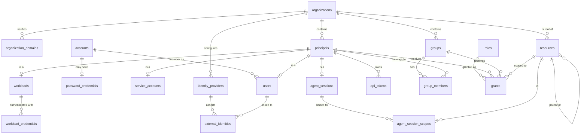

# IAM data model

- Status: Draft for review
- Date: 2026-10-02
- Related: [ADR 0001](../adr/0001-deployment-topology.md), [ADR 0003](../adr/0003-identity-access-and-policy.md), [ADR 0004](../adr/0004-credentials-and-keys.md), [ADR 0005](../adr/0005-data-model-ownership.md), [ADR 0006](../adr/0006-release-and-delivery-tracking.md)

This document defines the data model for the IAM capability in the control plane (`apps/control-plane/internal/iam`). Once it is approved, the schema in the appendix becomes the first golang-migrate migration, and the Go domain types and repository interface follow from it.

## Decisions this model is built on

- **The tenant is the Organization.** An Organization sits above Workspace. It owns members, identity-provider configuration, and billing, and it contains many Workspaces. A self-hosted installation is the same system with one Organization. This answers the open question in ADR 0001.
- **Access uses built-in roles granted at a scope.** Fixed roles (owner, admin, member, viewer) are granted at Organization, Workspace, Project, Environment, or Source scope, and a grant applies to everything beneath that scope. Roles are rows in a table, so custom roles can be added later without a schema rewrite.
- **Grants only allow; policy denies.** IAM has no deny grants. Restrictions such as "this Session may not reach production" belong to policy ([ADR 0003](../adr/0003-identity-access-and-policy.md)).
- **IAM tables live in their own PostgreSQL schema, `iam`.** Each capability gets its own schema, which makes ownership visible in the database and keeps cross-capability joins obvious in review ([ADR 0005](../adr/0005-data-model-ownership.md)).
- **golang-migrate manages the schema.** Hand-written, versioned `.up.sql`/`.down.sql` files live in `apps/control-plane/internal/iam/migrations/`, embedded via `go:embed` and applied together with every other capability's migrations at control-plane startup; there is no separate desired-state schema file to diff against ([ADR 0005](../adr/0005-data-model-ownership.md)).
- **Primary keys are prefixed ULIDs, generated by the application.** A row's ID is a 3-character type prefix, an underscore, and a ULID (e.g. `org_01ARZ3NDEKTSV4RRFFQ69G5FAV`), stored as `varchar(30)`. The prefix makes an ID's type legible in logs, URLs, and support tickets without a lookup, and sorts chronologically within a type. Postgres has no default for these columns; the repository layer generates the ID before insert.

  | Table | Prefix |
  |---|---|
  | organizations | `org` |
  | accounts | `acc` |
  | resources | *(mirrors the owning entity's own prefixed ID)* |
  | principals | `prn` |
  | identity_providers | `idp` |
  | external_identities | `xid` |
  | api_tokens | `tok` |
  | workload_enrollment_tokens | `wet` |
  | workload_credentials | `wcr` |
  | oauth_clients | `ocl` |
  | oauth_refresh_tokens | `ort` |
  | roles | `rol` |
  | groups | `grp` |
  | grants | `grt` |

  Subtype tables (`users`, `service_accounts`, `agent_sessions`, `workloads`) share their parent `principals` row's `prn_` ID rather than minting their own. `signing_keys.kid` stays an opaque JWKS key id rather than following this convention.
- **Enumerated values are validated in application code, not database constraints.** Columns with a fixed set of values (`status`, `kind`, `resource_type`, `protocol`, `component`, `registration`, `source`) have no `check` constraint and no default. The repository layer validates against the allowed set before writing, so the allowed values live in one place (Go) instead of being duplicated between code and schema. Structural rules that are not value lists, such as "a grant has exactly one grantee", stay as `check` constraints.
- **A person has one account and can belong to many Organizations.** In the managed cloud, one person can work in several Organizations. A platform-scoped **accounts** row is the person; each `users` row is that account's membership in one Organization. Everything that grants, audit, and tenant isolation depend on stays Organization-scoped, so adding accounts does not weaken tenant isolation. A self-hosted installation uses the same model with one Organization.

## Entities

### Tenancy

- **organizations** — the tenant. Has a globally unique `slug`, a required `display_name`, a status (`active`, `suspended`, `deleted`), and optional `logo_url` and `metadata` for product-facing presentation. Creating an Organization also provisions its default Workspace, in the same transaction, through a provisioning interface that the workspace capability implements ([workspace data model](workspace-data-model.md)).
- **organization_domains** — email domains an Organization has verified. Used to route a login to the right identity provider in the managed cloud. Ownership is proven with a DNS TXT token, stored only as a hash. Several Organizations may claim a domain, but only one can hold it verified.
- **accounts** — the person, **platform-scoped** (no `organization_id`), like `oauth_clients`. Holds the sign-in email (unique across the platform, case-insensitive), a default display name, and a status. An account has no access on its own; access comes only through its memberships.

### Resource hierarchy

- **resources** — IAM's own copy of the hierarchy that grants attach to: Organization → Workspace → Project → Source, with Environments beside Projects under their Workspace (Organization → Workspace → Environment). Granting at an Environment controls who may deploy there, for example to staging but not to production ([ADR 0006](../adr/0006-release-and-delivery-tracking.md)).

  Workspaces, Projects, Environments, and Sources are owned by other capabilities (Workspaces and Projects by the [workspace capability](workspace-data-model.md), Sources by the [version-control capability](version-control-data-model.md), Environments by the delivery capability), and IAM must not join their tables. So each owning capability registers its resources through the IAM interface when it creates, moves, or deletes them. A resource row uses the same ID as the entity it mirrors, and the Organization's root row uses the Organization's ID.

### Principals

Every actor is a row in **principals**, the common parent table that grants and audit records point to. `kind` selects which subtype table holds the details:

| Kind | Subtype table | What it is |
|---|---|---|
| `user` | **users** | One account's membership in one Organization. An account has at most one membership per Organization. |
| `service_account` | **service_accounts** | A non-human integration that uses API tokens, e.g. CI or SCIM provisioning. |
| `agent_session` | **agent_sessions** | The identity of one orchestrated Session. Links to the Session and Work Item, the delegating principal, an expiry, and a revocation time. |
| `workload` | **workloads** | An enrolled data-plane component (worker, indexer, gateway, runtime agent) with its pool and last-seen time. |
| `agent` | **agents** | A durable agent identity, such as `release-agent`, that can belong to Teams and hold grants. Every agent Session runs as one Agent. How the Agent runs (harness, model, instructions) belongs to orchestration, not IAM; today its system prompt lives in `orchestration.agent_configs`, keyed by the Agent's principal ID. *Added by [ADR 0007](../adr/0007-teams-and-agent-identity.md). An Agent is created through a Team, which keeps it in at least one Team; Sessions do not run as Agents yet.* |

**Principals are never hard-deleted.** Audit and provenance records refer to them, so they are suspended or deactivated instead.

**A person in several Organizations has one account and one user principal per Organization.** Grants, group memberships, API tokens, and audit records point to the Organization-scoped user principal, never to the account. Removing someone from an Organization deactivates that membership's principal and leaves their account and other memberships alone.

**How sign-in reaches an Organization depends on who vouched for the person:**

- **Platform credentials** (a password on the account, or a future platform-level social login) authenticate the account. The person then chooses one of their Organizations, and the session is issued for that membership.
- **An Organization's identity provider** (OIDC or SAML) signs the person in to that Organization only. `external_identities` link to the user principal, not to the account, so an Organization admin who controls an identity provider can never sign someone in to a different Organization.
- **Joining an Organization** links a new membership to an existing account only when the account holder accepts an invitation, or when the email is in one of that Organization's verified `organization_domains`. JIT or SCIM provisioning with an unverified domain creates a new account rather than attaching to someone else's. The exception is a self-hosted installation's providers that its configuration manages: the operator chose them for the installation's one Organization, so a first sign-in through one with a verified email links the existing account with that email. In the managed cloud, a platform sign-in (`account_identities`) links an existing account only when both the account's email and the provider's are verified.

### Authentication

- **identity_providers** — per-Organization sign-in configuration. `protocol` is `oidc`, `saml`, `builtin`, `google`, or `github`. Google is OIDC with a fixed issuer; GitHub is OAuth 2.0 plus GitHub's user API, because it issues no ID token. `config` holds non-secret settings (issuer, client ID, metadata URL, the GitHub base URL for GitHub Enterprise Server) and, for `google` and `github`, who may sign in: `allowed_domains`, `allowed_organizations`, or `allowed_emails`, at least one of which must be set. A GitHub identity's subject is its numeric user ID. In a self-hosted installation, providers set in the control plane's configuration are written here on every start, with `config.managed_by` set to `configuration`; the API refuses to change those rows, and a provider removed from the configuration is disabled, not deleted, so its `external_identities` survive. Secrets are stored as a credential reference in `secret_ref` ([ADR 0004](../adr/0004-credentials-and-keys.md)). `jit_provisioning` controls whether a first login creates the user.
- **external_identities** — links a user to an identity-provider subject (OIDC `sub` or SAML NameID). The pair (provider, subject) is unique.
- **account_identities** — links an account to a platform provider's subject (`google` or `github`), so a person can sign up for and sign in to the managed cloud before belonging to any Organization. Unlike `external_identities`, it authenticates the account, and the person then chooses an Organization. The pair (provider, subject) is unique.
- **password_credentials** — argon2id password hashes for the built-in provider. One per account (platform-scoped), so a person has one password across all their Organizations.
- **api_tokens** — long-lived tokens for users (CLI, API) and service accounts. Only a hash and a short display prefix are stored. A token acts with its owner's grants.
- **workload_credentials** and **workload_enrollment_tokens** — a workload enrolls once with a single-use token, then authenticates with a bearer token, an mTLS certificate, or a Kubernetes service-account identity. `(kind, identifier)` is unique, and bearer credentials keep only a SHA-256 hash. Enrolment tokens may be bound to a Target.

### OAuth authorization server

- **oauth_clients** — MCP and API clients. These are **platform-scoped, not tenant-scoped**, because dynamic client registration and client metadata documents happen before any tenant is known. Consent and tokens are tenant-scoped.
- **oauth_authorization_codes** — short-lived, single-use codes with a PKCE challenge and target resource (RFC 8707).
- **oauth_refresh_tokens** — rotating refresh tokens grouped into a `family_id`. If a refresh token that was already rotated is used again, the whole family is revoked.
- **signing_keys** — per-Organization signing keys. The public key is published through JWKS; the private key is a reference to the credentials capability or KMS. Status runs `active` → `retiring` → `retired`, so verifiers keep accepting old keys during rotation.

**Access tokens are not stored.** They are short-lived JWTs that gateways and runners verify offline through `pkg/identity`.

### Authorization

- **roles** — built-in roles are rows with no Organization (`organization_id` is NULL), seeded by migration. A future custom role is a row that belongs to an Organization. The permissions of built-in roles are defined in Go code, so they are versioned with the binary.
- **groups** and **group_members** — manual or SCIM-provisioned groups. A third kind, team-managed groups ([ADR 0007](../adr/0007-teams-and-agent-identity.md)), mirrors each Team so it can receive grants: `source` is `team` and `external_id` the Team's ID. Only the Team capability changes their membership, through `iam.TeamGroups`, and their members can include Agents. An archived Team's group has no members, so grants to it stop applying until the Team is restored.
- **grants** — gives a role to exactly one principal or one group, on one resource. Grants can optionally expire.
- **agent_session_scopes** — the resources an agent Session is limited to.

| Built-in role | Grantable at | Summary |
|---|---|---|
| owner | Organization only | Everything, including identity-provider setup, billing, managing owners, and deleting the Organization |
| admin | Organization, Workspace | Manage members, grants, Workspaces, Projects, Environments, Sources, policies, and credentials; cannot manage owners or delete the Organization |
| member | Any scope | Create and work on Work Items, start Sessions, read code intelligence for resources in scope |
| viewer | Any scope | Read-only |

Permissions are strings named by resource and verb, such as `source.read`, `session.create`, `grant.manage`, `deployment.create`, and `identity_provider.manage`. The full catalog lives in code next to the role definitions.

## How an authorization check is evaluated

`Authorize(principal, permission, resource)`:

1. **Load the resource's ancestors.** Fetch the resource and its parents from `resources` with a recursive query. The hierarchy is at most four levels deep.
2. **Expand the principal's identity.** Use the principal plus the groups it belongs to. If the principal is an agent Session, use its **delegator** instead, and check that the Session is not expired or revoked. *Proposed in [ADR 0007](../adr/0007-teams-and-agent-identity.md):* also use the Agent the Session runs as. An autonomous Session has no delegator, so only the Agent's access is used.
3. **Collect grants.** Gather the unexpired grants for those identities on the resource or any of its ancestors.
4. **Check the permission.** Map the granted roles to permissions in code; the check passes if any role includes the requested permission.
5. **Apply the Session scope.** For an agent Session, the resource must also be one of its scope resources or a descendant of one. Effective access is the delegator's access intersected with the Session's scope. *Proposed in [ADR 0007](../adr/0007-teams-and-agent-identity.md):* it is also intersected with the access of the Agent the Session runs as.
6. **Continue to policy.** A successful IAM check is followed by policy evaluation in the single authorizer ([ADR 0003](../adr/0003-identity-access-and-policy.md)).

Every step uses indexed lookups bounded by tenant. The results can be cached per request. Caching across requests requires invalidation whenever grants or group memberships change.

## Invariants

- **Every tenant-scoped table has `organization_id`.** Each such table declares `unique (organization_id, id)`, and child tables reference parents through the composite key `(organization_id, <parent>_id)`. This makes a cross-tenant reference impossible at the database level.
- **Tenant filtering is enforced in application code; there is no row-level security.** Every repository method on a tenant-scoped table takes an Organization and filters by it. `roles` queries also include built-in rows (NULL Organization). `accounts`, `password_credentials`, and `oauth_clients` are the platform-scoped tables without tenant scoping. The only cross-Organization read is listing an account's memberships at sign-in, which is a dedicated repository method keyed by account, not a general unfiltered query. Repository tests cover tenant isolation for every method.
- **No raw secrets are stored.** Tokens are hashed (SHA-256), passwords are hashed with argon2id, and identity-provider secrets and private signing keys are credential references.
- **Subtypes match their principal kind.** A `users` row must belong to a principal of kind `user`, and so on. The repository layer enforces this when it creates principals.
- **Every Organization keeps at least one active owner.** The service layer enforces this when grants are removed or principals are deactivated.
- **A Session's delegator must be an active user or service account.** Deactivating the delegator makes the Session's authorization checks fail. *Proposed in [ADR 0007](../adr/0007-teams-and-agent-identity.md):* the delegator becomes optional. An autonomous Session has none, and policy requires a human user's approval before it releases any change.
- **Resource rows mirror their owning capability.** Deleting a Workspace, Project, Environment, or Source soft-deletes its resource row and its descendants, and the grants on them stop applying.
- **IAM changes emit audit events.** Grants, token issuance, sign-ins, and enrollments produce events for the audit and provenance capability. IAM does not keep its own audit tables.

## Open questions

- **Shared runners in the managed cloud.** Ivaldi-operated runners that serve many tenants would need a platform-level principal that receives per-job, tenant-scoped credentials. *Proposed in [ADR 0015](../adr/0015-platform-workloads.md):* platform workloads, workload principals with no Organization, declared in configuration; the gateway is the first. Per-job tenant-scoped credentials for shared runners are still open.
- **Issuer and signing keys.** Answered for now by [ADR 0012](../adr/0012-token-issuer-and-signing-keys.md): one platform issuer, signing with keys from the configuration. `signing_keys` is kept for per-Organization keys, which would let a gateway in a customer's data plane trust only that customer's tokens.
- **Narrowing API tokens.** Should an API token be restrictable to fewer permissions than its owner has, the way GitHub's fine-grained tokens are?
- **SCIM authentication.** Should SCIM use a dedicated service account with an API token, or a separate SCIM bearer-token table?

## Appendix: schema

The schema is implemented as golang-migrate migrations in [`apps/control-plane/internal/iam/migrations/`](../../apps/control-plane/internal/iam/migrations/), one table per migration. Those files are the source of truth ([ADR 0005](../adr/0005-data-model-ownership.md)); this document describes intent and does not repeat the SQL. Target: PostgreSQL 18 (`NULLS NOT DISTINCT` needs 15 or later).

| Migration | Creates | Scope |
|---|---|---|
| 000001 | `iam` schema | — |
| 000002 | `organizations` | tenant root |
| 000003 | `resources` | tenant |
| 000004 | `principals` | tenant |
| 000005 | `accounts` | platform |
| 000006 | `users` | tenant |
| 000007 | `service_accounts` | tenant |
| 000008 | `agent_sessions` | tenant |
| 000009 | `workloads` | tenant |
| 000010 | `identity_providers` | tenant |
| 000011 | `external_identities` | tenant |
| 000012 | `password_credentials` | platform |
| 000013 | `api_tokens` | tenant |
| 000014 | `workload_enrollment_tokens` | tenant |
| 000015 | `workload_credentials` | tenant |
| 000016 | `oauth_clients` | platform |
| 000017 | `oauth_authorization_codes` | tenant |
| 000018 | `oauth_refresh_tokens` | tenant |
| 000019 | `signing_keys` | tenant |
| 000020 | `roles`, seeded with the four built-in roles | platform and tenant |
| 000021 | `groups` | tenant |
| 000022 | `group_members` | tenant |
| 000023 | `grants` | tenant |
| 000024 | `agent_session_scopes` | tenant |
| 000025 | `organization_domains` | tenant |
| 000026 | `account_identities` | platform |
| 000027 | `agents` | tenant |
| 000028 | a unique index on team-managed `groups` (`source = 'team'`, one per Team) | tenant |
| 000029 | `users.last_signed_in_at`, set when the user redeems an authorization code | tenant |
| 000030 | `workload_enrollment_tokens.target_id` and `.credential_kind`, binding enrollment to a Target and method | tenant |
| 000031 | `workload_credentials.secret_hash` and `.replaced_by`, for bearer credentials and renewal lineage | tenant |
