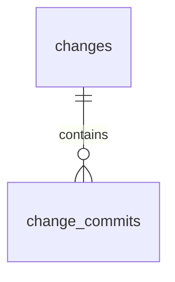

# Provenance data model

- Status: Draft for review
- Date: 2026-11-08
- Related: [ADR 0005](../adr/0005-data-model-ownership.md), [ADR 0006](../adr/0006-release-and-delivery-tracking.md), [ADR 0007](../adr/0007-teams-and-agent-identity.md), [version-control data model](version-control-data-model.md), [delivery data model](delivery-data-model.md)

This document defines the provenance capability in the control plane (`apps/control-plane/internal/provenance`). It records **Changes**: the commits in a Source and the Session and Work Item that produced them. Delivery derives release notes through it, so a Deployment can trace back through its Builds' commits to the work that produced them.

## Decisions this model is built on

- **A Change is the link from commits to work.** It records one or more commits in one Source, the Session that produced them, and the Work Item they serve. Sessions and Work Items are owned by other capabilities and are stored as plain IDs, with no foreign keys (ADR 0005).
- **A commit belongs to at most one Change in its Source.** The database enforces this with a unique key on `(organization_id, source_id, commit_sha)`, so release notes never have to choose between two attributions for one commit.
- **Ivaldi does not derive Changes from commit messages or provider metadata.** The Session or automation that produced the commits records the Change. This keeps attribution explicit and audit-visible rather than inferred from conventions.
- **Changes are immutable.** They are recorded once. A correction is a new Change for the corrected commits; the incorrect one is not edited, because release notes and audit records may already refer to it.
- **Recording is authorized on the Source.** A Change belongs to a Source, which IAM mirrors as a resource under its Project. Recording needs `change.record`; reading needs `change.read`.
- **Recording emits an event and an audit record** in the same transaction as the write.

## Entities

- **changes** — one attribution of commits to work.
  - `source_id` names the Source the commits belong to.
  - `session_id` and `work_item_id` are optional: CI may record a Change with neither, and a human-only commit may have only a Work Item.
  - `title` describes the change, and `external_ref` points at a pull request or review when one exists.
  - `created_by_principal_id` records who recorded it.
- **change_commits** — the commits a Change contains. The primary key `(organization_id, source_id, commit_sha)` makes each commit's attribution unique within its Source.

## How the main flows work

**Recording a Change.** A Session, a CI job (`ivaldictl change record`), or another automation calls `POST /v1/sources/{source_id}/changes` with the full commit SHAs, a title, and optionally its Session and Work Item. The capability validates the SHAs and writes the Change, its commits, its outbox event, and its audit record in one transaction. A commit already recorded for the Source is refused with `409`.

**Release notes.** Delivery asks for the Changes holding the commits a Release would add to a Target and those it would remove, through `provenance.Lookup`. For each commit it finds, the release change carries the Change ID, Session ID, and Work Item ID. Commits with no recorded Change remain listed, with those fields null.

## Invariants

- **Every table has `organization_id`**, and `change_commits` references `changes` through `(organization_id, change_id)`, so a commit cannot join another tenant's Change.
- **A commit belongs to one Change per Source.**
- **Every Change has at least one commit.**
- **Changes are never edited or deleted** in place; a correction is a new record.
- **A Change's commits share its Source and Organization.**

## Open questions

- **Grouping changes.** A Change currently groups commits the recorder explicitly names. When the Session capability lands, it should record one Change per coherent unit of work, rather than one per commit.
- **Corrections.** Should an incorrectly recorded Change be superseded by a new one with an explicit link, or only corrected by recording the right commits?
- **Attribution when Ivaldi did not observe the commit.** Can a later Session claim a commit recorded by CI? The unique key currently refuses a second Change for the same commit.

## Appendix: schema

Migrations live in [`apps/control-plane/internal/provenance/migrations/`](../../apps/control-plane/internal/provenance/migrations/), one table per migration, embedded with `go:embed`.

| Migration | Creates | Scope |
|---|---|---|
| 000001 | `provenance` schema | — |
| 000002 | `changes` | tenant |
| 000003 | `change_commits` | tenant; unique commit per Source |
