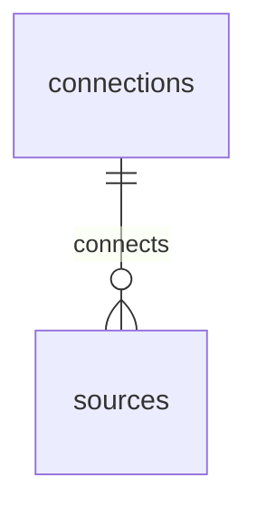

# Version-control data model

- Status: Draft for review
- Date: 2026-10-18
- Related: [ADR 0002](../adr/0002-gateway-integration-ingress.md), [ADR 0004](../adr/0004-credentials-and-keys.md), [ADR 0005](../adr/0005-data-model-ownership.md), [ADR 0008](../adr/0008-reaching-customer-systems.md), [IAM data model](iam-data-model.md), [workspace data model](workspace-data-model.md), [delivery data model](delivery-data-model.md)

This document defines the data model for the version-control capability in the control plane (`apps/control-plane/internal/versioncontrol`). The capability owns how an Organization connects to its version-control providers, and the Sources (repositories) connected through them. Other capabilities refer to Sources by ID: delivery's Applications and Builds, and later Changes and the indexer's code-intelligence records. The storage-free shared part, provider interfaces and the types for refs and commits, lives in `pkg/vcs`.

## Decisions this model is built on

- **The capability owns Connections and Sources, and nothing else.** A Connection is how an Organization reaches one provider account. A Source is one repository connected through it. Changes and pull requests, which link a Session's work to commits, belong to a separate capability that uses this one. Clones and checkouts stay in the data plane, with the worker and the indexer.
- **Connections belong to the Organization, not a Workspace.** A provider account, such as a GitHub organization with Ivaldi's app installed, usually holds repositories for many Workspaces. One Connection serves all of them.
- **A Source sits under exactly one Project.** IAM's resource hierarchy is a tree (Project → Source), so a repository has one parent. A monorepo shared by several teams becomes one Project with several Applications, each with its own owning Team. Allowing a Source in several Projects would break how grants are inherited.
- **Sources are identified by the provider's repository ID, not by name.** Names change when a repository is renamed or transferred. The provider's ID does not. `full_name` is kept up to date from provider events.
- **Ivaldi does not mirror commits.** The provider is the source of truth for commits and refs. Capabilities that need commit history, such as delivery comparing two Releases, ask through `pkg/vcs`, using the Connection's lookup path ([ADR 0008](../adr/0008-reaching-customer-systems.md)).
- **Lookups run where the provider can be reached.** A Connection records whether its lookups run from the control plane or from a data-plane workload, so a self-hosted VCS inside a customer's network never has to be reachable from Ivaldi's cloud ([ADR 0008](../adr/0008-reaching-customer-systems.md)).
- **Webhook routing is resolved from a unique key.** Each Connection that receives webhooks has a `webhook_route_key`, such as a GitHub App installation, that is unique across the whole platform. The gateway cannot read the control-plane database ([ADR 0002](../adr/0002-gateway-integration-ingress.md)), so it resolves the key through a read-only control-plane API defined in `schemas/`, and it may cache the answer. The gateway calls it as a platform workload, signing each call with its own key, and the authorizer allows only a platform gateway to resolve routes ([ADR 0015](../adr/0015-platform-workloads.md)).
- **Sources are registered with IAM as resources.** When a Source is connected, this capability registers an IAM resource with the same ID under its Project, in the same transaction ([IAM data model](iam-data-model.md)).
- **No secrets are stored.** Access tokens, app private keys, and webhook secrets are credential references ([ADR 0004](../adr/0004-credentials-and-keys.md)).
- **Conventions match the other capabilities.** Tables live in their own PostgreSQL schema, `version_control`. Every table has `organization_id` and a `unique (organization_id, id)` key, and child tables use composite foreign keys. Tenant filtering is enforced in application code, with one exception noted below. Enumerated values are validated in Go. Primary keys are prefixed ULIDs generated by the application, stored as `varchar(30)`. References to other capabilities have no foreign key.

  | Table | Prefix |
  |---|---|
  | connections | `vcn` |
  | sources | `src` |

## Entities

- **connections** — how an Organization reaches one provider account.
  - `provider` names the provider (`github`, `gitlab`, `bitbucket`, `gitea`, or `azure_devops`), and `host_url` its address, such as `https://github.com` or a self-hosted server.
  - `auth_kind` says how Ivaldi authenticates (`app_installation`, `oauth`, or `access_token`), and `credential_ref` points to the credential.
  - `external_account_id` and `external_account_name` identify the provider account, such as the installation ID and the GitHub organization's login.
  - `webhook_route_key` is the platform-wide key the gateway uses to route this Connection's webhooks; NULL if the Connection receives none. `webhook_secret_ref` points to the secret the gateway checks signatures with.
  - `lookup_from` and `lookup_pool` say where lookups run ([ADR 0008](../adr/0008-reaching-customer-systems.md)).
  - `status` is `active`, `suspended` (for example, the provider suspended the installation), or `revoked` (the app was uninstalled or the token revoked). A Connection that is not active cannot be used for lookups, and its Sources show as disconnected.
  - `created_by_principal_id` records who connected it. Connections are soft-deleted with `deleted_at`.
  - `provider_updated_at` is the provider's timestamp of the newest webhook applied to the Connection, which orders its webhooks (see Receiving a webhook).
- **sources** — one repository, connected through a Connection and placed under one Project.
  - `external_repo_id` is the provider's stable repository ID, and `repository_key` combines it with the provider and host (for example `github:github.com:123456`). `repository_key` is unique among an Organization's active Sources, so the same repository cannot be connected twice, even through two Connections.
  - `full_name` (such as `acme/checkout`), `default_branch`, `visibility` (`public`, `private`, or `internal`), `clone_url`, and `web_url` are kept up to date from provider events.
  - `project_id` is the Project the Source belongs to, and `workspace_id` is copied from it. Projects never move between Workspaces, so the copy stays correct ([workspace data model](workspace-data-model.md)).
  - `upstream_archived_at` records when the provider archived the repository. `archived_at` records when it was disconnected from Ivaldi.
  - `provider_updated_at` is the provider's timestamp of the newest webhook applied to the Source, which orders its webhooks (see Receiving a webhook).
  - Sources are never hard-deleted, because Builds, Changes, and audit records refer to them.

## How the main flows work

**Connecting a provider.** An Organization admin installs Ivaldi's app or provides a token. An app installation is connected only through the install flow: the frontend asks the control plane to start it and sends the admin to the provider with sealed state bound to the admin and the Organization. The provider sends them back with an authorization code and the installation ID, and the frontend passes those to the control plane. The control plane checks the state is the caller's own, exchanges the code for the admin's user token, and records the Connection only if the installation is one of the App's installations the admin can access. An installation ID on its own proves nothing, because installation IDs are sequential and anyone can type one. The Connection's `webhook_route_key` (for example `github:github.com:42`) is unique across the platform, so an installation belongs to one Organization at a time. A token is stored through the credentials capability. The control plane contacts only the provider host it is configured with, never a host a Connection names.

**Connecting a Source.** A Project admin picks a repository that the Connection can see. In one transaction, the capability inserts the Source and registers its IAM resource under the Project. It emits a connected event, which the indexer and other capabilities can react to.

**Receiving a webhook.** The gateway checks the signature with the provider's webhook secret (the GitHub App's secret for now), resolves `webhook_route_key` to the Organization and Connection, and maps the payload's repository ID to a Source by `repository_key`. Events for repositories that are not connected Sources are acknowledged and dropped. Repository events (renamed, transferred, default branch changed, archived) update the Source. Installation events (suspended, uninstalled) update the Connection's `status`.

Webhooks can be handled out of order: a provider's redelivery can arrive late, and the control plane handles several events at once. Each Source and Connection therefore keeps `provider_updated_at`, the provider's timestamp (GitHub's `updated_at` on the repository or installation) of the newest webhook applied to it, and ignores a webhook older than that. The timestamp moves even when the webhook changed nothing else, so an unarchive handled before the archive it followed still refuses that archive. Equal timestamps are not refused, because providers report whole seconds and two events can share one. A webhook without a timestamp is applied without being ordered. A Source starts from the provider's `updated_at` of the repository it was connected from, and a refresh (below) is ordered the same way, so a webhook from before either cannot undo it.

**Choosing a repository.** To connect a Source, the web app lists the repositories a Connection's account lets Ivaldi read (`GET /v1/connections/{id}/repositories`, which needs `connection.read`). The list is asked of the provider each time and never stored, because Ivaldi does not mirror the provider and the list changes whenever someone changes the installation's repository access.

**Comparing commits.** Delivery, or any other capability, asks for the commits between two SHAs in a Source. The request goes through `pkg/vcs` and the Connection's lookup path, and returns commit IDs, authors, and messages only ([ADR 0008](../adr/0008-reaching-customer-systems.md)).

**Connection status.** A provider can suspend an installation or revoke it. `POST /v1/connections/{id}/suspend` and `/revoke` record those states, and `/reactivate` makes a suspended Connection usable again. A suspended or revoked Connection cannot be used for lookups, so Sources that use it cannot be refreshed or restored until it is active; their own state does not change. Revoking is final: a revoked Connection can only be archived, which frees its account to be connected again. Provider webhook events apply these transitions too, and an administrator can still call them directly.

**Refreshing a Source.** `POST /v1/sources/{id}/refresh` re-reads the repository from the provider and updates its full name, default branch, visibility, and URLs. It recovers from a webhook the provider failed to deliver. The provider's `updated_at` orders it with webhooks: a refresh older than a webhook already applied changes nothing, and one that changes the Source moves `provider_updated_at`. A refresh that finds nothing to change saves nothing. The Source keeps its ID because it is keyed by the provider's stable repository ID.

**Archiving.** This capability registers with the workspace capability as a dependent: a Project with active Sources cannot be archived ([workspace data model](workspace-data-model.md)). Disconnecting a Source sets `archived_at` and soft-deletes its IAM resource. Records that refer to it keep working, because the row stays.

## Invariants

- **Every table has `organization_id`**, and `sources` references `connections` through `(organization_id, connection_id)`, so a Source cannot use another tenant's Connection.
- **`webhook_route_key` is unique across the platform** among Connections that are not deleted, so every webhook routes to exactly one Organization. Resolving it is the only lookup in this capability that is not filtered by tenant. Like listing an account's memberships in IAM, it is a dedicated method keyed by the route key, not a general unfiltered query.
- **`repository_key` is unique within an Organization** among active Sources.
- **Every active Source has an active IAM resource with the same ID**, under its Project, written in the same transaction.
- **A Source's `workspace_id` matches its Project's**, checked through the workspace capability's interface when the Source is connected.
- **Connections marked `data_plane` are never contacted from the control plane** ([ADR 0008](../adr/0008-reaching-customer-systems.md)).
- **Version-control changes emit events** for the audit and provenance capability: Connections created, suspended, revoked, or removed; Sources connected, updated, or disconnected.

## Open questions

- **Transferred repositories.** When a repository moves to a provider account covered by a different Connection, should the Source follow it to the new Connection automatically, or wait for an admin?
- **Several Sources per Application.** Applications have one optional `source_id`. Is that enough when an Application's artifacts are built from more than one repository?
- **Provider-specific settings.** Do some providers need per-Source settings, such as which branches send webhooks or which events to subscribe to?

## Appendix: schema

The migrations live in [`apps/control-plane/internal/versioncontrol/migrations/`](../../apps/control-plane/internal/versioncontrol/migrations/), one table per migration, embedded with `go:embed`. Those files are the source of truth for the schema. Their versions are kept in `public.version_control_schema_migrations`, separate from the other capabilities' version tables (see the [delivery data model](delivery-data-model.md#appendix-planned-schema)).

| Migration | Creates | Scope |
|---|---|---|
| 000001 | `version_control` schema | — |
| 000002 | `connections` | tenant; `webhook_route_key` is unique platform-wide |
| 000003 | `sources` | tenant |
