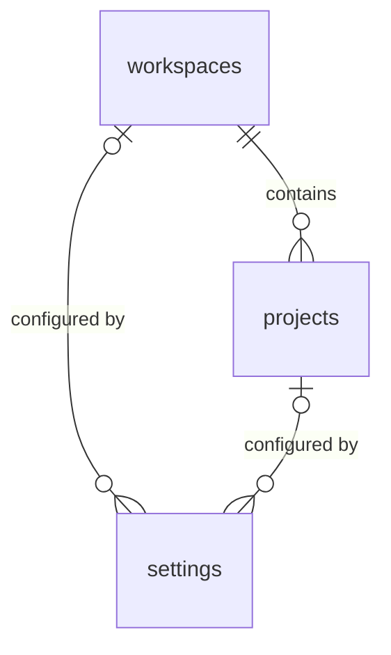

# Workspace data model

- Status: Draft for review
- Date: 2026-10-18
- Related: [ADR 0001](../adr/0001-deployment-topology.md), [ADR 0003](../adr/0003-identity-access-and-policy.md), [ADR 0005](../adr/0005-data-model-ownership.md), [ADR 0007](../adr/0007-teams-and-agent-identity.md), [IAM data model](iam-data-model.md), [delivery data model](delivery-data-model.md)

This document defines the data model for the workspace capability in the control plane (`apps/control-plane/internal/workspace`). The capability owns Workspaces and Projects, the two levels of the resource hierarchy between an Organization and the things teams work on. Other capabilities hang their records off them: delivery's Environments, Lifecycles, and Registries belong to a Workspace, and its Applications belong to a Project. Those capabilities refer to Workspaces and Projects by ID and reach them only through this capability's interface ([ADR 0005](../adr/0005-data-model-ownership.md)).

The capability also stores **settings**: configuration values set at Organization, Workspace, or Project level, such as the default Lifecycle for new Channels. It stores and resolves them, but each setting is defined, validated, and interpreted by the capability it configures.

## Decisions this model is built on

- **A Workspace belongs to an Organization, and a Project belongs to a Workspace.** The Organization is the tenant and is owned by IAM ([IAM data model](iam-data-model.md)). An Organization can have many Workspaces, and a Workspace many Projects.
- **Every Organization has a default Workspace, provisioned with it.** When IAM creates an Organization, this capability creates its default Workspace (slug `default`, display name "Default") in the same transaction, so people can start working without choosing a structure first. A self-hosted installation, which has one Organization, therefore always has one too. IAM calls a provisioning interface that the control plane wires to this capability at startup, so IAM does not depend on this capability. The default Workspace's display name and slug can be changed like any other Workspace's, during managed-cloud sign-up or at any time later. It cannot be archived while it is the default, but the default can be moved to another active Workspace.
- **Every Project is owned by a Team.** As with Applications ([ADR 0007](../adr/0007-teams-and-agent-identity.md)), ownership means responsibility, not access: work about the Project is routed to the owning Team, and access still comes from IAM grants. The owning Team is also the default owner of new Applications in the Project. An Application keeps its own owner afterwards, so handing a Project to another Team does not change who owns its existing Applications. Workspaces have no owning Team; ownership starts at Projects.
- **Sources are not part of this capability.** A Source is a repository, and it carries VCS provider details: the connection or app installation, the provider's repository ID, and how webhooks map to it ([ADR 0002](../adr/0002-gateway-integration-ingress.md)). Those belong with VCS integration, so Sources are owned by the [version-control capability](version-control-data-model.md). It places each Source under one Project, as the IAM hierarchy expects, and registers as a dependent so a Project with active Sources cannot be archived.
- **Workspaces and Projects are registered with IAM as resources.** When this capability creates one, it registers an IAM resource with the same ID: a Workspace under its Organization's root resource, and a Project under its Workspace. This is what lets grants be given at Workspace or Project scope. Registration happens in the same database transaction as the insert, through IAM's interface, so a Workspace never exists without its resource row.
- **Projects do not move between Workspaces.** Delivery copies a Project's Workspace onto each Application and ties Applications to that Workspace's Environments, Lifecycles, and Registries. Moving a Project would break those links, so `workspace_id` never changes. To reorganize, create a new Project. Supporting moves is deferred (see the end of this document).
- **Workspaces and Projects are archived, never hard-deleted.** Other capabilities' records, audit events, and provenance refer to them. Archiving soft-deletes the matching IAM resource, so grants on it stop applying.
- **Archiving is refused while dependents are active.** Before archiving a Project, this capability asks every capability that registered as a dependent whether it still has active records under it. Delivery, for example, answers for its Applications. Archiving a Workspace also requires all its Projects to be archived first, and asks dependents about Workspace-level records such as Environments. This capability never queries their tables. Each dependent implements a small interface that the control plane wires in at startup.
- **Settings are stored centrally and defined by the capability that owns them.** One table holds every setting value, so a Workspace's settings can be listed, changed, and audited in one place. Each capability registers its settings in Go at startup. A definition gives the key, namespaced by the capability (for example `delivery.default_lifecycle`); the value's type and default; the levels it may be set at; the IAM permission needed to change it; and a validation function. The owning capability validates every change, for example that a Lifecycle ID exists in the Workspace. A key with no registered definition is rejected.
- **Settings resolve from the most specific level.** A setting for a Project resolves to the Project's value if it has one, then its Workspace's, then the Organization's, then the default in the definition. The answer always says which level it came from, so people can see why a value applies. A definition can limit the levels a setting may be set at; for example, a setting that only makes sense per Workspace.
- **Settings are configuration, not policy.** A setting changes defaults and behavior, such as which Lifecycle a new Channel starts with. Anything that decides whether an action is allowed, denied, or needs approval belongs to policy ([ADR 0003](../adr/0003-identity-access-and-policy.md)), and a setting definition that does so is rejected in review.
- **Organizations and Workspaces lock settings through policy.** A lock is a policy rule, owned by the policy capability, not a column here. An Organization can lock a key for all its Workspaces and Projects, and a Workspace can lock a key for its own Projects. Each lock has two effects:
  - Changes to the key below the lock's level are denied by policy when they are authorized.
  - Resolution ignores values below the lock's level and returns the value resolved at the lock's level, marked as locked. For a Workspace lock, that is the Workspace's value, or the Organization's, or the definition's default.

  An Organization lock wins over a Workspace lock: a Workspace cannot change a key the Organization has locked, so its own lock on that key has no effect. Values below a lock are kept but inactive, and the product shows them as overridden by the lock, so removing the lock brings them back. To resolve quickly, this capability reads locked keys from the policy capability's interface and caches them until a policy change event clears the cache.
- **Locks are changed like settings.** Adding or removing a lock is a policy change authorized at the lock's level: an Organization lock needs admin on the Organization, and a Workspace lock admin on the Workspace. Because a lock changes which setting values apply, an agent Session needs a human's approval to add or remove one, as it does for settings ([ADR 0007](../adr/0007-teams-and-agent-identity.md)).
- **Every setting change is auditable.** Each change or removal is recorded through the audit capability's interface in the same transaction as the write, so a setting can never change without its audit record. The record holds the level, the key, the old and new values, the principal, the Session if there was one, the approving human, and `policy_decision_id`. Changes that wait for approval, lapse, or are refused are recorded by the policy capability as decisions. A setting's history in the product is read from these audit records, so this capability keeps no history table.
- **Agents never change settings alone.** Any agent Session, with or without a human delegator, needs a human's approval to change or remove a setting of any kind ([ADR 0007](../adr/0007-teams-and-agent-identity.md)). `policy_decision_id` records the decision behind the current value.
- **Settings never hold secrets.** A setting that needs a secret holds a credential reference ([ADR 0004](../adr/0004-credentials-and-keys.md)).
- **Slugs are unique among active records only.** A Workspace's slug is unique within its Organization, and a Project's within its Workspace, among records that are not archived. An archived slug can be reused.
- **Conventions match the IAM and delivery models.** Tables live in their own PostgreSQL schema, `workspace`. Every table has `organization_id` and a `unique (organization_id, id)` key, and child tables use composite foreign keys. Tenant filtering is enforced in application code. Primary keys are prefixed ULIDs generated by the application, stored as `varchar(30)`. References to other capabilities, here the Organization and IAM principals, have no foreign key.

  | Table | Prefix |
  |---|---|
  | workspaces | `wsp` |
  | projects | `prj` |

## Entities

- **workspaces** — a space in an Organization where related work happens, with its own Projects, Environments, and release strategies. Has a `slug` that is unique among the Organization's active Workspaces, a display name, and an optional description. `is_default` marks the Organization's default Workspace; a partial unique index allows one per Organization, and a check stops it from being archived. `created_by_principal_id` records who created it; it is NULL for the default Workspace, which the system creates. `archived_at` marks it archived.
- **projects** — a body of work in a Workspace, such as a product or service area, holding its Applications, Sources, and Work Items. Has a `slug` that is unique among the Workspace's active Projects, a display name, an optional description, and an `owner_team_id` naming its owning Team. `workspace_id` never changes. `created_by_principal_id` records who created it. `archived_at` marks it archived.
- **settings** — one setting value at one level. The level is implied by which IDs are set: neither `workspace_id` nor `project_id` for the Organization, `workspace_id` alone for a Workspace, and both for a Project. A composite foreign key checks that a Project setting's Project belongs to the Workspace it names. `key` must be namespaced by a capability, `value` is JSON of at most 16 KB, and there is one value per key and level. `version` increases with every change, and updates compare it, so two people changing the same setting cannot silently overwrite each other. `updated_by_principal_id` records who last changed it, and `policy_decision_id` refers to the authorizer's decision for that change, including any human approval. The table has no row ID; the level and key identify a row.

## How the main flows work

**Provisioning a new Organization.** In the transaction that creates the Organization, IAM calls this capability's provisioner. It inserts the default Workspace with `is_default` set and registers its IAM resource under the Organization's root resource. If either step fails, the Organization is not created.

**Creating a Workspace or Project.**
1. IAM authorizes the caller: managing Workspaces needs admin on the Organization, and creating a Project needs admin on the Workspace (see the built-in roles in the [IAM data model](iam-data-model.md)).
2. For a Project, the capability checks through the Team capability's interface that the owning Team is active and in the same Organization.
3. In one transaction, the capability inserts the row and registers the IAM resource under its parent.
4. It emits a created event for the audit and provenance capability.

**Handing a Project to another Team** sets `owner_team_id` after the same Team check, and is recorded as an audit event. A Team that still owns active Projects cannot be deleted until they are handed over.

**Moving the default Workspace.** In one transaction, the capability clears `is_default` on the current default and sets it on another active Workspace. The old default can then be archived like any other Workspace.

**Archiving a Project.**
1. The capability asks each registered dependent whether it has active records under the Project. If any does, archiving is refused, and the refusal lists what is still active, such as "3 active Applications".
2. Otherwise, in one transaction, it sets `archived_at` and soft-deletes the IAM resource, which stops grants on the Project from applying.
3. It emits an archived event.

**Archiving a Workspace** works the same way, but also requires every Project in it to be archived first.

**Changing a setting.**
1. The capability looks up the key's definition and refuses unknown keys, and levels the definition does not allow.
2. The owning capability validates the value.
3. The single authorizer decides: IAM checks the definition's permission on the level's resource (the Organization, Workspace, or Project), then policy decides. Policy denies a Workspace- or Project-level change to a key the Organization has locked, and a Project-level change to a key its Workspace has locked. If the caller is an agent Session, policy always requires a human's approval ([ADR 0007](../adr/0007-teams-and-agent-identity.md)), and the proposed change waits with the policy capability; nothing is written yet.
4. In one transaction, the capability writes the value and records the change through the audit capability. The write checks `version` against the version the caller read, or, for an approved change, the version when approval was requested. If it no longer matches, the write is refused and an approval lapses. The row records `policy_decision_id`.
5. After the transaction commits, it emits a changed event so caches of resolved values are cleared.

Removing a setting at a level deletes its row, so the value from the next level up applies again. Removing goes through the same authorization, so an agent Session needs approval to remove a setting too.

**Resolving a setting.** Capabilities ask for a key at the most specific level they have, usually a Project or a Workspace. The workspace capability reads at most three rows by indexed key. If the Organization has locked the key, it returns the Organization's value, or the definition's default, marked as locked. Otherwise, if the Workspace has locked it, it returns the Workspace's value, or the Organization's, or the default, marked as locked. Otherwise it picks the most specific value and falls back to the definition's default. It returns the value, the level it came from, and whether it is locked. Results can be cached briefly, and the cache is cleared by setting and policy change events.

**Restoring.** An archived Workspace or Project can be restored if its slug is still free. Restoring also restores its IAM resource. Grants that existed before archiving apply again, unless they expired in the meantime.

## Invariants

- **Every table has `organization_id`**, and `projects` references `workspaces` through `(organization_id, workspace_id)`, so a Project cannot belong to another tenant's Workspace.
- **Every active Workspace and Project has an active IAM resource with the same ID**, under the right parent. The repository layer writes both in one transaction.
- **A Project's `workspace_id` never changes.**
- **A Project cannot be created in an archived Workspace**, and a Workspace with active Projects cannot be archived.
- **Every Organization has exactly one default Workspace, and it is active.** The partial unique index allows at most one, the check stops it from being archived, and provisioning creates it with the Organization.
- **Every active Project has an owning Team** that is active and in the Project's Organization, checked through the Team capability's interface.
- **Archiving never leaves active dependents behind.** Every capability that keeps records under a Workspace or Project registers as a dependent and answers the archive check.
- **Every stored setting has a registered definition**, and its value passed that definition's validation when it was written. When a definition is removed from code, a migration deletes its stored values.
- **A Project setting names the Project's own Workspace**, enforced by a composite foreign key.
- **Settings keep their values while their Workspace or Project is archived**, so restoring brings them back.
- **No agent Session's setting change is written without a human's approval**, recorded in `policy_decision_id`. Policy enforces this; the workspace capability stores the decision and never skips the call.
- **No setting changes without an audit record.** The audit record is written in the same transaction as the change.
- **Workspace changes are recorded** by the audit and provenance capability: created, renamed, archived, and restored; default moved; Project ownership handed over; and settings changed or removed.

## Deferred

- **Moving Projects between Workspaces.** Projects stay in their Workspace. A move could later be offered as an explicit migration that recreates the Project's delivery records in the new Workspace. It is deferred until customers need it.

## Appendix: schema

The migrations live in [`apps/control-plane/internal/workspace/migrations/`](../../apps/control-plane/internal/workspace/migrations/), one table per migration, embedded with `go:embed`. Those files are the source of truth for the schema. Their versions are kept in `public.workspace_schema_migrations`, separate from the other capabilities' version tables (see the [delivery data model](delivery-data-model.md#appendix-planned-schema)).

| Migration | Creates | Scope |
|---|---|---|
| 000001 | `workspace` schema | — |
| 000002 | `workspaces`, with the one-default-per-Organization index | tenant |
| 000003 | `projects`, with `owner_team_id` | tenant |
| 000004 | `settings`, plus a `(organization_id, workspace_id, id)` key on `projects` for its foreign key | tenant |
